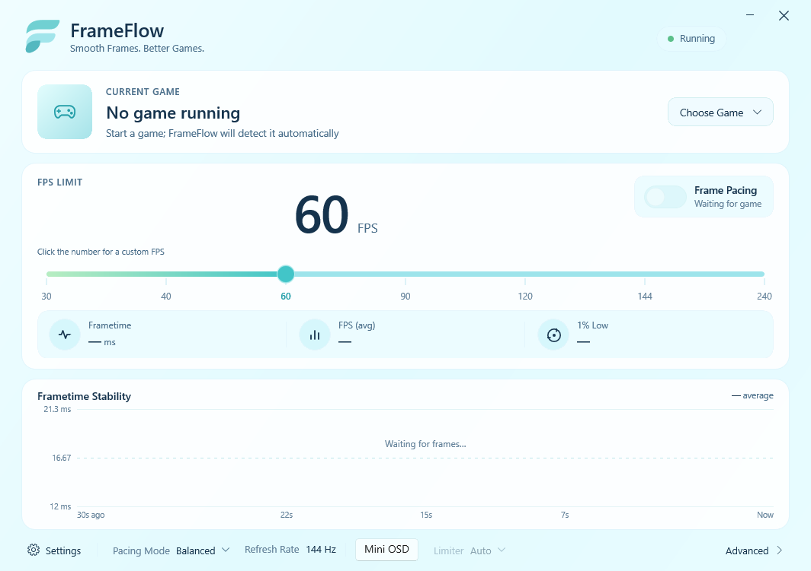

# FrameFlow


Smooth Frames. Better Games.



*FrameFlow main window before selecting a game.*

FrameFlow is a lightweight Windows utility that limits a game's frame rate on an absolute,
drift-free timeline so frames arrive evenly spaced. It detects the running game, remembers a
profile per game, and shows live frametime statistics. Protected games are skipped by default.

This repository includes the validated pacing engine and an **experimental DX11/DX12 hook**.
The hook can attach automatically to a selected game started normally, or load at startup through
`FrameFlow.Launch.exe`. It has not yet been validated against a broad game compatibility matrix.
Automatic hooking is disabled for Euro Truck Simulator 2 after repeated crashes observed with
version 1.61.1.9. FrameFlow detects the game without modifying its process; an NVIDIA driver limit
can be selected manually if available.

## What works today

| Area | Status |
|---|---|
| Deadline-based pacing engine (QPC, high-resolution waitable timer, yield + spin) | Done, benchmarked |
| FrameFlow.Engine: detection, per-game profiles, telemetry, named-pipe IPC | Done |
| FrameFlow.UI (WinUI 3): main window, settings, advanced page | Done |
| FrameFlow.TestRenderer (DX11), paced by the engine exactly like a hooked game | Done |
| FrameFlow.Benchmark: accuracy and CPU cost report | Done |
| Anti-cheat detection (protected games skipped by default, explicit per-game risk choice) | Done |
| DX11 / DX12 in-game integration (`FrameFlow.Hook64.dll`, normal launch or launcher) | Experimental |
| FrameFlow Mini: FPS, frametime and graph over the game | Experimental |
| DX12 probe, paced through the hook and engine | Done |
| Tray, global hotkeys | Phase 5 |

Measured on the development machine (GTX 1080, 16 logical CPUs, Windows 10 22H2):

* Test renderer paced by the engine at 60 FPS for 39 s: average 16.6667 ms, std. dev. 0.0018 ms,
  P99 deviation 0.0083 ms, 1% low 59.97 FPS.
* `FrameFlow.Benchmark` (Balanced): P99 deviation ≤ 0.006 ms from 30 to 240 FPS. A naive `Sleep()`
  limiter asked for 60 FPS delivered 32.4 FPS on the same machine.
* CPU cost of the waiting phases: ~5% of one core at 60 FPS (≈0.3% of total CPU), rising to ~22% of one
  core at 240 FPS. Full table: `docs/benchmark-report.md`.

Run `benchmark.bat` to measure your own machine.

## Build & Packaging

Requirements: Visual Studio 2022 with *Desktop development with C++* (includes CMake and Ninja),
Windows 10 SDK, and a .NET SDK 8 or newer (a per-user install works).

```
build.bat            native engine + tools (CMake/Ninja/MSVC) and the WinUI app, output in bin\
test.bat             unit tests (CTest)
benchmark.bat        timing benchmark, writes docs\benchmark-report.md
package-portable.bat builds the standalone ZIP distribution in dist\
tools\package-installer.ps1 builds a compressed Windows Setup EXE from the standalone package
run.bat              starts FrameFlow (the UI starts the engine)
run-testrenderer.bat starts the DX11 test renderer; FrameFlow detects and paces it
bin\FrameFlow.Launch.exe "C:\path\to\game.exe" [arguments]  optional early-hook launch for x64 DX11/DX12 games
```

## Portable Version

FrameFlow supports zero-install, fully isolated portable execution:

* **Staging and Archive**: Run `package-portable.bat nopause` to generate `dist\FrameFlow-Portable\`, `dist\FrameFlow-v1.0.1-Portable.zip`, and its `.sha256` checksum.
* **Portable Detection**: Activated automatically if a `.portable` marker file or `data\` directory is present alongside the executables, or when `--portable` / `%FRAMEFLOW_PORTABLE%=1` is passed.
* **Isolated Data**: All profiles, UI and engine settings, and logs are stored inside the portable folder (`.\data\Profiles\`, `.\data\Logs\`, `.\data\ui-settings.json`, `.\data\engine-settings.json`). Nothing is written to `%LOCALAPPDATA%` or the Windows Registry.
* **Launcher**: Open `FrameFlow.exe` or use the included `run.bat` shortcut.

The downloadable ZIP contains Windows x64 binaries and their runtime files. Extract the entire archive
before launching it; running the executable from inside the ZIP is unsupported. The release is
experimental: DX11/DX12 hooks depend on each game's presentation path, and a detected game does not
necessarily mean that its frame limit is active. Verify **Frame Pacing** and live statistics in the UI.

For a smaller download, the release also includes `FrameFlow-v1.0.1-Lite.zip`. It requires the
x64 .NET 8 Runtime already installed. Windows App SDK Runtime 1.7 is included in both ZIPs. The
standalone Portable ZIP also includes .NET 8 and is the safer choice for machines without it.

`FrameFlow-v1.0.1-Setup.exe` is a compressed, per-user Windows installer that includes both
runtimes. It installs shortcuts and an uninstaller without administrator rights. Settings and
profiles for this edition are stored under `%LOCALAPPDATA%\FrameFlow` and remain after uninstall.
The installer is not code-signed.

## Layout

```
apps/FrameFlow.UI            WinUI 3 app (C#, .NET 8, self-contained)
apps/FrameFlow.Engine        background engine (C++20)
apps/FrameFlow.TestRenderer  DX11 test scene using the same PresentPacer a hook will use
apps/FrameFlow.DX12Probe     minimal DX12 swap-chain target for hook validation
apps/FrameFlow.SessionProbe  read-only live present-cadence diagnostics for a hooked process
apps/FrameFlow.Benchmark     pacing accuracy + CPU cost measurement
native/Core                  logging, JSON, paths, strings
native/Timing                Clock, WaitableTimer, FramePacer (deadline timeline + hybrid wait)
native/Telemetry             frame statistics (FPS, 1%/0.1% low, deviation) and graph buckets
native/ProcessDetection      process scanner, game scoring, exclusions, anti-cheat detection
native/Profiles              per-game JSON profiles
native/Display               monitor + refresh detection, refresh-aware presets
native/IPC                   named pipe server, shared-memory session, protocol
native/Graphics              IGraphicsBackend, PresentPacer (in-process pacing client)
apps/FrameFlow.Launch        startup launcher and running-process attach helper
native/Hooks                 experimental DXGI import and swap-chain hooks
shared/Protocols             IPC protocol specification
tests/                       unit tests (no external framework)
docs/                        architecture, roadmap, benchmark reports
```

## Data locations

For a normal source build, `%LOCALAPPDATA%\FrameFlow\` stores profiles, settings and logs. The
portable release stores these under its own `data\` directory. Nothing is uploaded; there is no
account and no analytics.

## Publishing

GitHub Actions builds and tests every pull request and push. Pushing a `v1.0.1` tag creates a
GitHub Release with the Setup EXE, Portable and Lite ZIPs, and SHA-256 checksums. The tag version must match the version
in `CMakeLists.txt` and `apps/FrameFlow.UI/FrameFlow.UI.csproj`.

FrameFlow's original source and assets are open source under the [MIT license](LICENSE). See
[third-party notices](THIRD_PARTY_NOTICES.md) for bundled components, and
[contributing guidelines](CONTRIBUTING.md) before submitting changes.

## Safety

FrameFlow does not hide from, bypass, or tamper with anti-cheat software. When Easy Anti-Cheat,
BattlEye, Riot Vanguard, FACEIT, Ricochet, EA AntiCheat, GameGuard or XIGNCODE3 is detected,
integration is disabled by default. The **Play at your own risk** button permits an attempt for
that game profile only after an explicit warning. The game's protection may reject it, and use
may violate game rules or put an account at risk. Detection is heuristic and cannot identify every
protection. If the engine stops, a paced process falls back to "pacing off" within two seconds.

## Experimental DX11 and DX12 game pacing

Start FrameFlow, choose a game's `.exe` with **Change Game**, then start the game normally from
Steam, its shortcut, or its own launcher. The engine detects the process and asks
`FrameFlow.Launch.exe` to attach the hook. **Launch Game** remains an optional early-hook path:
it briefly uses Windows debugging events to pause at the executable entry point, loads the hook,
and detaches before the game begins. By default, both paths skip protected games. The hook
intercepts standard `D3D11CreateDevice`, `D3D11CreateDeviceAndSwapChain`, and DXGI factory imports,
and can patch common DXGI Present vtables after a game has already created a swap chain. It paces
the first visible swap chain immediately before `Present` / `Present1`. The UI controls it
through the same shared-memory session as the test renderer. If the engine exits, pacing stops within
two seconds. The hook remains loaded until the game exits; it is not detached at runtime.

This path is **not yet a universal game limiter**. Automatic attachment can arrive after a game
has created a private or unsupported swap chain; some games reject external hooks or use
unsupported presentation paths. In those cases Auto reports that FrameFlow cannot limit the game;
NVIDIA is available only when explicitly selected.
Check that the UI reports the FrameFlow pacing method before treating the FPS limit as precise.

For each detected game, choose **Limiter** in the bottom bar: **Auto** uses the in-process
FrameFlow hook when a session is attached and never enables the NVIDIA limiter;
**FrameFlow** requires a live DX11/DX12 hook session, established automatically where supported;
**NVIDIA** explicitly selects the driver limiter. The selected preference is saved in that game's profile. NVIDIA's driver limit
accepts whole FPS values, while FrameFlow accepts up to three decimal places. Click the large FPS
number to type any value from 10 to 1000; the slider markers are shortcuts only. The separate
**Pacing Mode** menu controls how FrameFlow waits for each frame, not which limiter is selected.
**Mini OSD** in the bottom bar opens FrameFlow's own small, click-through window over the selected
game. It shows FPS, 1% low, frametime, and a short frametime graph. No RTSS installation is needed.
The mini follows the game window and hides when the game is minimized or no longer in the foreground.
It works with windowed and borderless presentation; exclusive fullscreen can cover desktop windows,
so the mini is not guaranteed there. FrameFlow's full graph remains in the main window.

The end-to-end smoke test uses the DX11 test renderer without its built-in pacer:

```
bin\FrameFlow.Launch.exe bin\FrameFlow.TestRenderer.exe --external-test-fps 60 --seconds 6 --report smoke.txt
```

This smoke path measures the hook independently of the UI and engine. For the full engine path,
start FrameFlow first and replace `--external-test-fps 60` with `--external`.

The DX12 smoke test uses a separate minimal command-queue swap chain:

```
bin\FrameFlow.Launch.exe bin\FrameFlow.DX12Probe.exe --fps 60 --seconds 6 --report dx12-smoke.txt
```

The `--fps` option above drives the hook session for testing. Omit it when testing control through
the FrameFlow engine. DX12 is identified by the `ID3D12CommandQueue` passed to DXGI when the swap
chain is created; the engine then reports the session as DX12.

For a live hooked game, `bin\FrameFlow.SessionProbe.exe <pid> 30` samples 30 seconds of the
shared present ring and prints frametime percentiles and intervals above the target. It measures
CPU-side calls to `Present`, not when each frame becomes visible on the monitor. Session version 5
also separates time outside the hook, hook overhead, the previous DXGI `Present` call, and
FrameFlow's wait.
